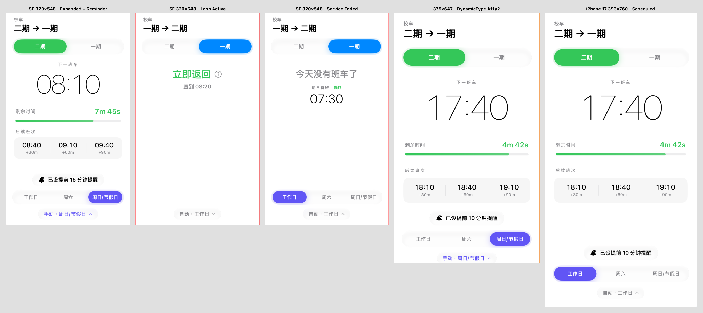
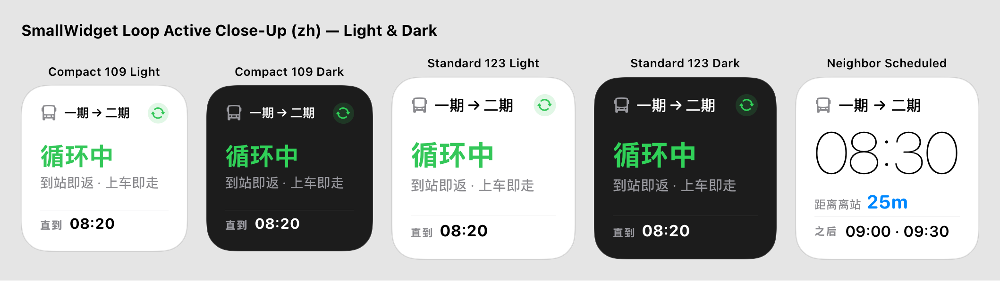
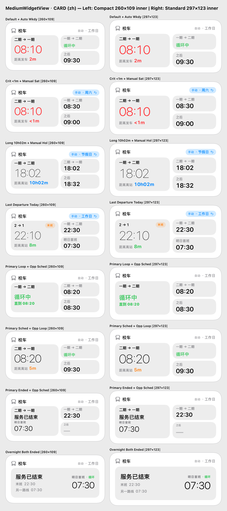
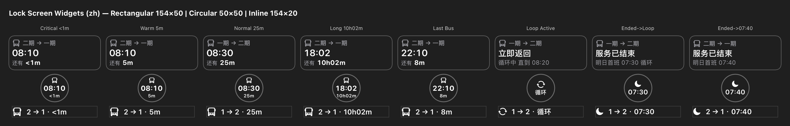
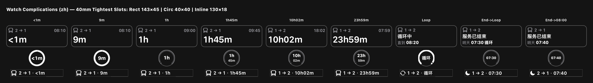

# 🚌 BNBU Bus

<p align="center">
  <strong>优雅、极简、无缝的校园巴士时刻表与桌面小组件</strong>
  <br />
  <em>专为北京师范大学-香港浸会大学联合国际学院（UIC / BNBU）二期新校区与一期停车场往返打造</em>
</p>

<p align="center">
  
  
  
  
  
</p>

---

## ✨ 亮点特色

不再需要打开又卡又慢的微信群或翻找相册里的时刻表长图。**抬手看表，或者看一眼 iPhone 锁屏和桌面，发车时间一目了然。**

- 📱 **纯粹的原生质感**：纯 SwiftUI + WidgetKit 构建，极致流畅的自适应弹性交互，支持浅色/深色外观与大字号无缝缩放。
- ⏱️ **全方位 WidgetKit 支持**：
  - **主屏幕小组件**：小号（Small）与中号（Medium · 卡片与极简双样式），多级字号自适应与文案降级，杜绝任何文字溢出或省略号。
  - **锁屏小组件**：圆形、矩形、单行组件，随时掌握最新发车时刻与倒计时。
- ⌚️ **独立 Apple Watch 体验**：一键切换往返方向，深度适配圆形进度环、矩形多行、行内以及 Infograph 角标等全套表盘复杂功能（Complications）。
- 🔄 **智能时刻表与接驳识别**：自动根据星期匹配工作日、周六、节假日时刻；无缝识别高峰期「到站即返 · 上车即走」的循环接驳车；支持夜间自动预告明日首班。
- 🔔 **轻量本地发车提醒**：无需联网，在 iPhone 上为下一班车一键预约提前 5、10 或 15 分钟的本地离站推送。
- ⚡️ **无缝双端同步**：通过 WatchConnectivity 与 App Group 实时同步方向偏好与手动日期覆盖。

---

## 📸 界面预览

### 📱 iPhone 主应用与多状态体验
> 无论是常规机型还是紧凑小屏，界面均能智能一屏呈现。高峰期循环接驳与夜间停运状态自动隐藏冗余提示，清爽干净。

<p align="center">
  
</p>

---

### 🎨 桌面小组件 (Home Screen Widgets)
> 经过像素级对齐优化的小号与中号组件，支持卡片与极简两种风格。无论紧急倒计时、超长等待、末班车还是循环接驳，均自然和谐。

<p align="center">
  
</p>
<p align="center">
  
</p>

---

### 🔒 锁屏小组件 (Lock Screen Accessories)
> 适配 iOS 锁屏 Vibrancy 磨砂半透明质感，圆形进度环、矩形发车详情与单行发车摘要全面支持。

<p align="center">
  
</p>

---

### ⌚️ Apple Watch 与表盘复杂功能 (Complications)
> 深度适配 40mm 紧凑表盘与 46mm 大表盘，曲面边缘安全留白，支持各样式 Apple Watch 表盘插槽。

<p align="center">
  
</p>

---

## 🛠️ 项目架构

项目采用纯 Swift Package 驱动的多端协同架构，数据逻辑与业务计算完全集中维护：

```text
Bus_Schedule/
├── Bus_Schedule/                  # 📱 iOS 主应用、视图与本地通知调度
├── Bus_ScheduleWidget/            # 🎨 iOS 桌面与锁屏小组件 (WidgetKit)
├── Bus_ScheduleWatch Watch App/   # ⌚️ watchOS 独立应用
├── Bus_ScheduleWatchWidget/       # ⏱️ watchOS 表盘复杂功能扩展 (Complications)
├── BusScheduleCore/               # 📦 共享 Swift Package（无任何第三方依赖）
│   ├── Sources/BusScheduleCore/   # 核心时刻表、状态机、偏好同步、文案格式化
│   └── Tests/BusScheduleCoreTests/ # 完整的边界条件与格式化单元测试套件
└── assets/                        # 🖼️ 开源展示截图资源
```

---

## 🚀 快速上手与本地编译

### 环境要求
- **macOS** 建议使用最新系统版本。
- **Xcode 16+**（内置 Swift 6.0 工具链）。
- **iOS 18.0+** / **watchOS 10.0+**。

### 运行步骤

1. 克隆代码仓库：
   ```bash
   git clone https://github.com/JerryyrreJ/Bus_Schedule_app.git Bus_Schedule
   cd Bus_Schedule
   ```

2. 用 Xcode 打开工程：
   ```bash
   open Bus_Schedule.xcodeproj
   ```

3. 选择运行 Scheme：
   - 调试 iPhone 应用及小组件：选择 **`Bus_Schedule`** 并在模拟器或真机上运行（`Cmd + R`）。
   - 调试 Apple Watch 应用及表盘：选择 **`Bus_ScheduleWatch Watch App`** 运行。

4. 运行核心逻辑单元测试：
   ```bash
   swift test --package-path BusScheduleCore
   ```

> 💡 **真机签名提示**：真机安装前，请在 Xcode 各 Target 的 **Signing & Capabilities** 中切换为你自己的 Development Team，并配置 App Group（默认为 `group.Jerry-Lu.Bus-Schedule`，可按需在 `SharedStore.swift` 中自定义）。

---

## 🤝 参与贡献

欢迎提交 Issue 和 Pull Request！如果你发现了时刻表调整、UI 边距微调建议或新功能构想，欢迎随时交流：

1. Fork 本仓库并新建分支 (`git checkout -b feature/awesome-feature`)
2. 提交修改 (`git commit -m 'feat: Add awesome feature'`)
3. 确保所有单元测试通过 (`swift test --package-path BusScheduleCore`)
4. 推送至分支 (`git push origin feature/awesome-feature`)
5. 发起 Pull Request 🎉

---

## 📄 开源许可证

本项目基于 [MIT License](LICENSE) 开源。
