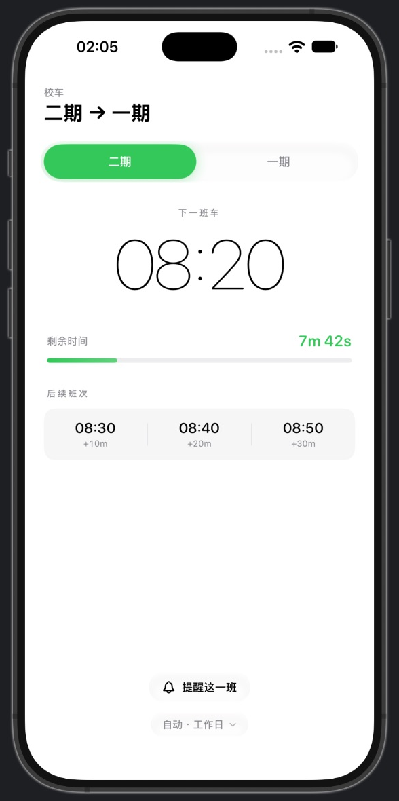
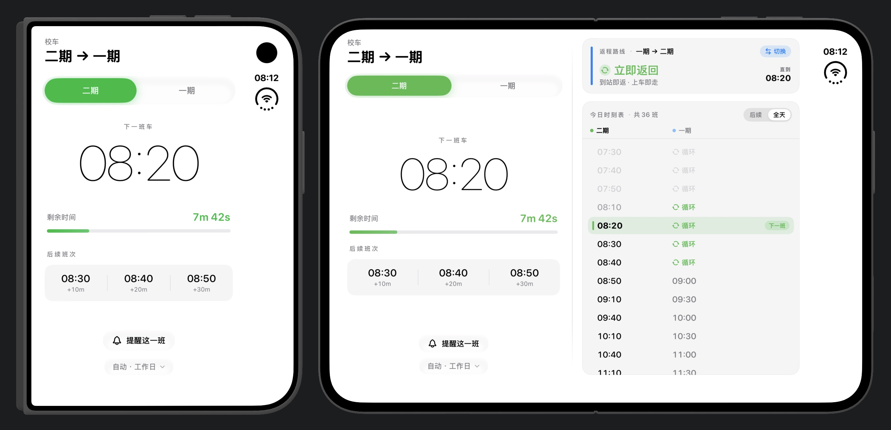
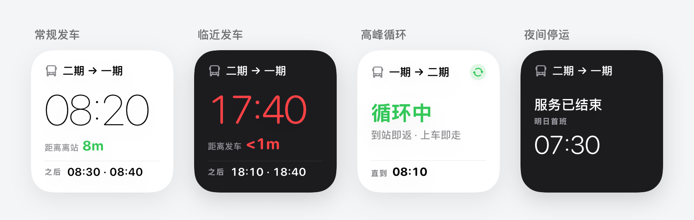
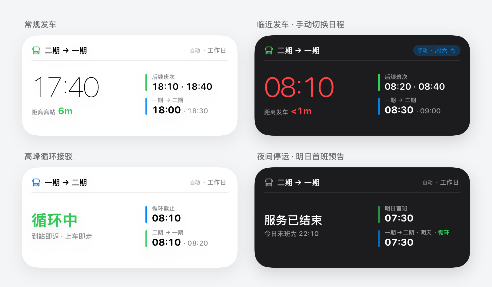
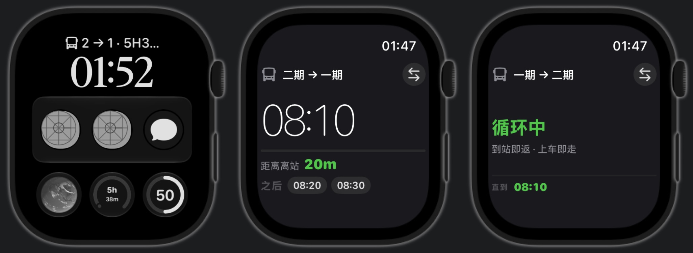

# BNBU Bus

  <strong>极简、原生、抬手即看的校园巴士时刻表与小组件</strong>
   
  <em>专为 BNBU 二期与一期往返校车打造</em>

  
  
  
  
  

---

## 界面预览

### iPhone

  

  <strong>自动匹配日程与离站提醒</strong> —— 自动识别工作日、周六与节假日班次，早午高峰无缝切换「立即返回」循环接驳状态；出发前可一键预约提前 5、10 或 15 分钟的本地发车提醒，不用再翻群聊或相册里的时刻表长图。

---

### 支持 iPhone Duo

  

  <strong>首发适配折叠屏「对开站牌」</strong> —— 合上外屏是单手即看的极简倒计时；展开内屏自动切换为左右双页对开，同屏查看另一校区的返程实时状态与全天往返时刻表，轻点即可一键对调路线，所有交互严格避开中央折痕。

---

### 桌面小组件

  

  

  <strong>主屏幕一眼掌握往返动态</strong> —— 提供小号与中号桌面小组件，深浅色模式自动切换。不打开应用也能在桌面同屏查看去程倒计时、返程班次与明日首班预告，遇到节假日调休还能直接在组件右上角一键临时切换日程。

---

### 锁屏小组件

  

  <strong>点亮屏幕即知剩余时间</strong> —— 支持时间上方的单行状态以及下方的圆形、矩形毛玻璃锁屏组件，赶课路上点亮屏幕就能确认下一班车还有几分钟发车。

---

### Apple Watch

  

  <strong>抬手看表，轻点切换方向</strong> —— 独立手表应用与手机实时同步方向偏好，点击顶部路线即可切换往返校区；同时适配圆形进度环、矩形卡片等表盘复杂功能，抬腕即知车况。

---

## 如何安装到自己的手机

无需付费开发者账号，只要有一台安装了 **Xcode** 的 Mac 和一根数据线，几分钟即可装进自己的 iPhone：

1. **下载并打开项目**：点击本页面右上角的绿色 **Code → Download ZIP** 下载并解压，双击打开文件夹里的 `Bus_Schedule.xcodeproj`。
2. **登录账号并修改标识**：
   - 点击 Xcode 左侧最顶部的蓝色 `Bus_Schedule` 图标，切到 **Signing & Capabilities** 标签页。
   - 在列表中每个 Target 下，将 **Team** 选为你自己的 Apple ID（若没有，点击 Add an Account 登录普通 Apple ID 即可），并把 **Bundle Identifier** 和下方 **App Groups** 里的 `Jerry-Lu` 改成你自己的英文名缩写。
   - 在左侧文件栏打开 `BusScheduleCore → Sources → BusScheduleCore → SharedStore.swift`，将第 18 行 `"group.Jerry-Lu.Bus-Schedule"` 里的 `Jerry-Lu` 也改成刚才相同的名字。
3. **连线一键安装**：用数据线将 iPhone 连接到 Mac，在 Xcode 顶部选择 `Bus_Schedule` 和你的手机，点击左上角的 **▶** 按钮即可安装上机（如需同步安装手表端，再切到 `Bus_ScheduleWatch Watch App` 点一次 **▶** 即可）。

> **首次安装提示**：如果之前没用 Xcode 给手机装过应用，首次运行需在 iPhone「设置 → 隐私与安全性 → 开发者模式」中开启开发者模式；安装完成后若提示「不受信任的开发者」，前往「设置 → 通用 → VPN 与设备管理」点击信任你的 Apple ID 即可正常打开。

---

## 开源许可证

本项目基于 [MIT License](LICENSE) 开源。
